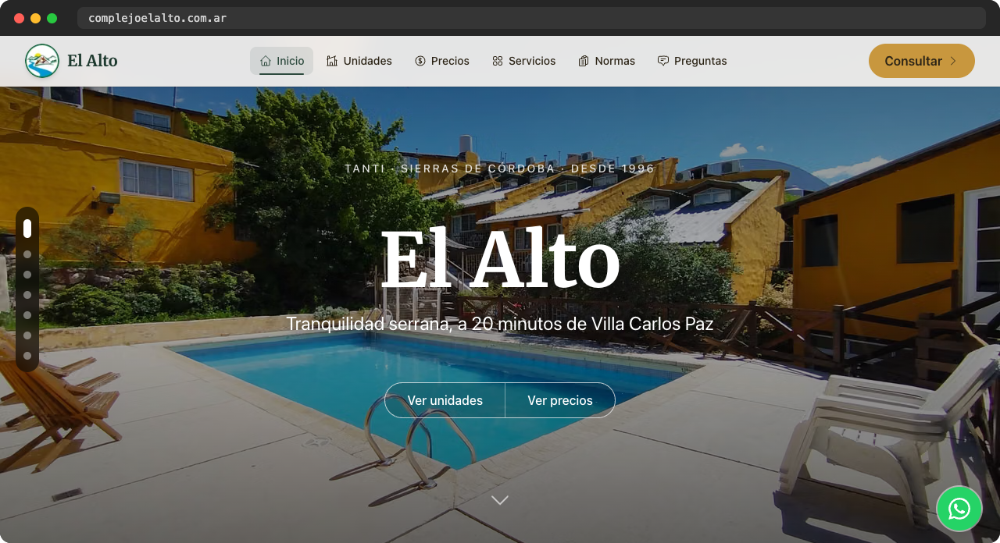
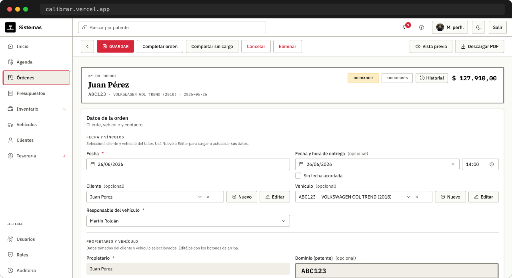

# Hi, I'm Leo 👋

### **QA Specialist at Communities.Tech · Co-founder & Developer at [JLRT Software](https://jlrt-software.com.ar)**
🇦🇷 Oncativo, Córdoba (UTC−3)&emsp;🌐 [leandrotrabucco.me](https://leandrotrabucco.me)&emsp;🔗 [LinkedIn](https://www.linkedin.com/in/leandro-trabucco/)&emsp;✉️ [Email](mailto:leandrotrabucco@gmail.com)

I test software, design MVPs, and build full-stack apps, from concept to production. [Le Wagon Tokyo](https://www.lewagon.com/tokyo) graduate, now studying programming at [UTN](https://www.utn.edu.ar/). Native Spanish, bilingual English, conversational Japanese & Portuguese, from years in multicultural teams in Japan.

---

## 🚀 Projects

### [El Alto](https://github.com/LeoCba07/el-alto-website)

Cabin rental website for a 30-year-old family business in Argentina. Its contact form and chatbot pre-fill WhatsApp with dates and guest count, since the owners estimated about 80% of inquiries arrived without them.

**Stack:** Next.js, TypeScript, Tailwind CSS, Sanity CMS, Vercel, Google Analytics, Playwright  
**Live:** [www.complejoelalto.com.ar](https://www.complejoelalto.com.ar)

 
 

### [Jidou Navi](https://www.jidou-navi.app)

A crowdsourced mobile app for discovering Japan's unique vending machines, with an interactive map and gamified check-ins. Lead developer since early 2026: built most of the app, with early help from a development partner. Now LIVE on Google Play Store (iOS TBD).

**Stack:** React Native, Expo, TypeScript, Supabase (PostgreSQL/PostGIS), Mapbox  
**Live:** [Google Play](https://play.google.com/store/apps/details?id=com.jidounavi.app) · iOS waitlist at [jidou-navi.app](https://www.jidou-navi.app)

 
 

### [Calibr.ar](https://calibrar.vercel.app)

Workshop management SaaS for auto repair shops in Argentina: repair orders, quotes, inventory and vehicle history. Built at [JLRT Software](https://jlrt-software.com.ar), where I designed the interface and design system and built many of its screens and the landing page. Live in production.

**Stack:** Next.js, TypeScript, Tailwind CSS, Supabase (PostgreSQL)  
**Live:** [calibrar.vercel.app](https://calibrar.vercel.app)

 

---

Last updated: 2026-11-26
